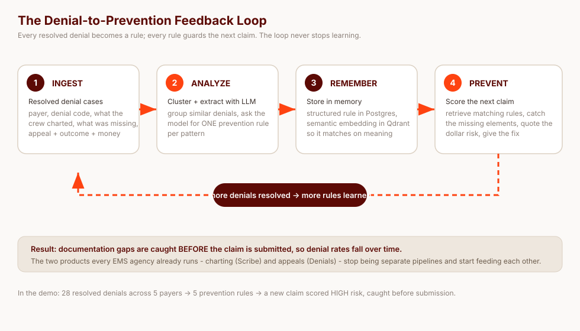
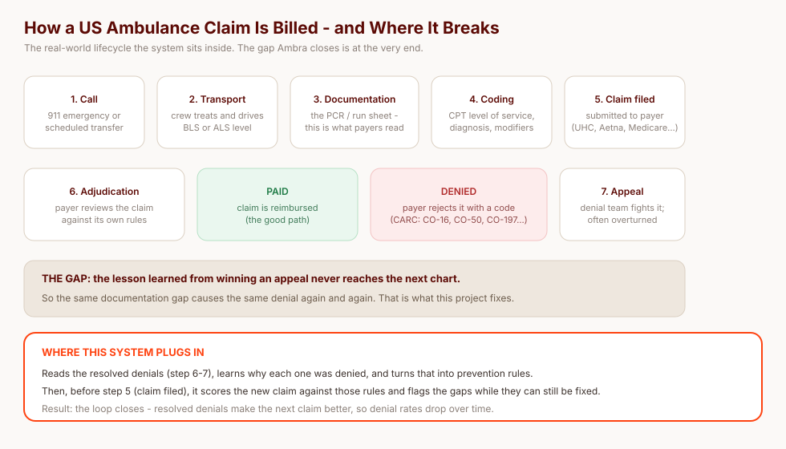
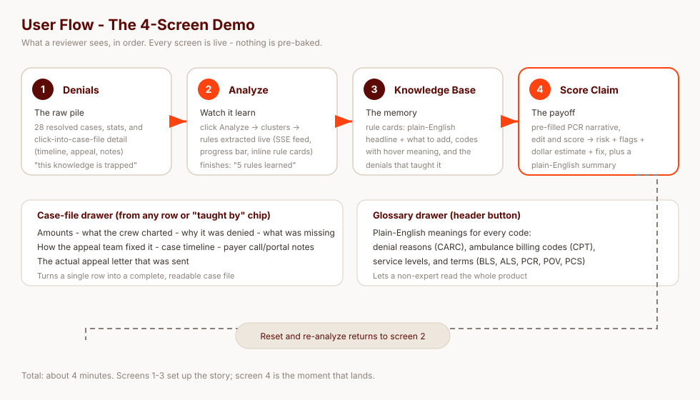
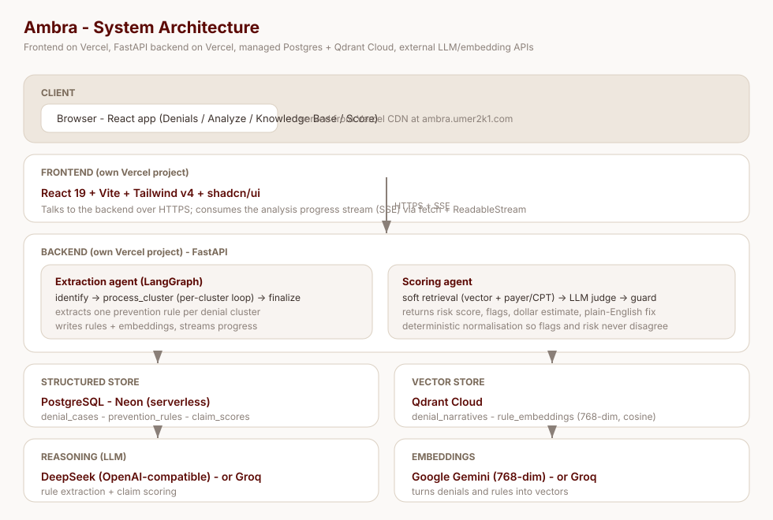
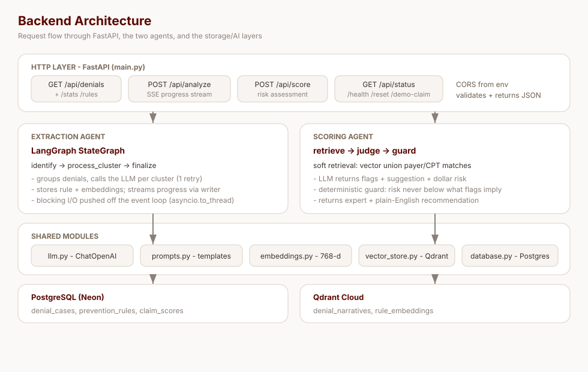
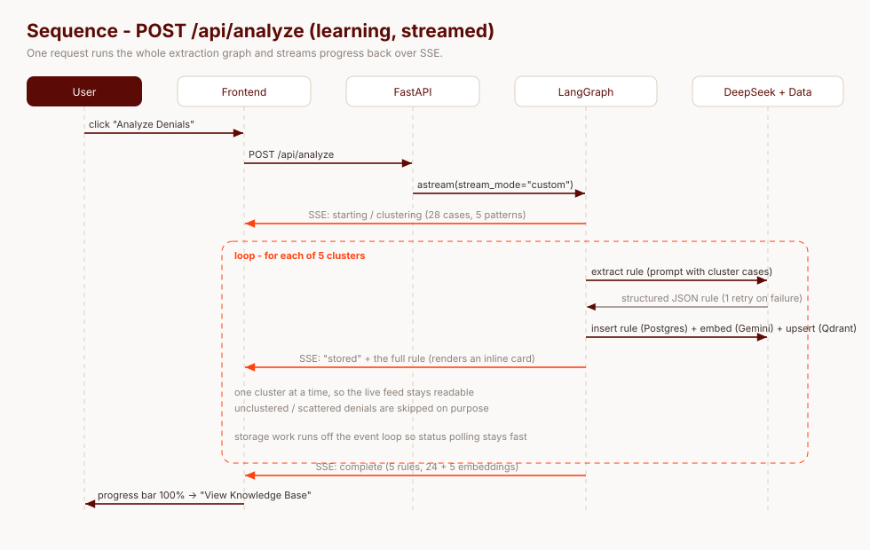
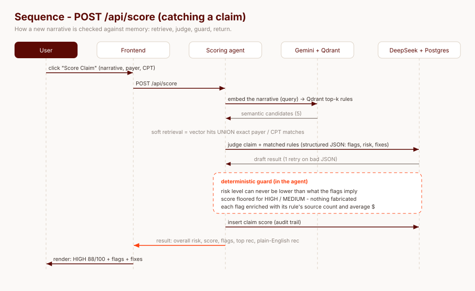
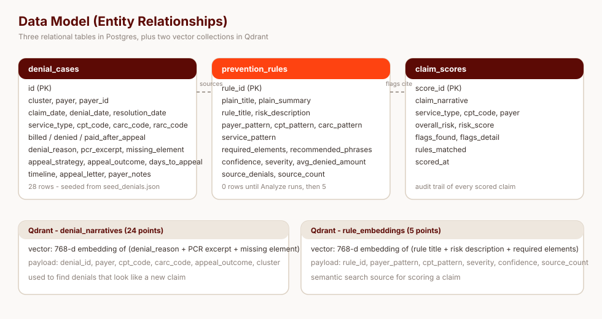

# Ambra — Denial-to-Prevention Feedback Loop

> A working prototype that turns every **resolved** ambulance-insurance denial into a **reusable prevention rule**, then uses those rules to catch documentation gaps in the **next** claim before it is ever submitted.

**Live demo:** https://ambra.umer2k1.com

---

## Table of contents

1. [What this is (in one minute)](#1-what-this-is-in-one-minute)
2. [Background: how ambulance billing works in the USA](#2-background-how-ambulance-billing-works-in-the-usa)
3. [The solution: a feedback loop](#3-the-solution-a-feedback-loop)
4. [What the demo shows (4 screens)](#4-what-the-demo-shows-4-screens)
5. [Architecture](#5-architecture)
6. [The two agents, in detail](#6-the-two-agents-in-detail)
7. [Data model](#7-data-model)
8. [Screenshots](#8-screenshots)
9. [API reference](#9-api-reference)
10. [The seed data](#10-the-seed-data)
11. [Coming from a clean machine: run it locally](#11-coming-from-a-clean-machine-run-it-locally)
12. [Configuration](#12-configuration)
13. [Deployment](#13-deployment)
14. [Testing](#14-testing)
15. [Roadmap](#15-roadmap)
16. [Glossary](#16-glossary)

---

## 1. What this is (in one minute)

An ambulance company bills an insurer for a transport. Sometimes the insurer **denies** the claim — most often because the **documentation** in the patient-care report is missing something the payer wanted to see. The agency appeals, often wins, and moves on.

**The lesson from that win never reaches the next patient-care report.** So the same documentation gap causes the same denial again, and again, and again. Charting and denial-appeals are two pipelines that never talk to each other.

This project **connects them**:

```
 resolved denials  →  learn prevention rules  →  remember them (vector memory)
        ▲                                                    │
        └──────────────  score the next claim  ◄──────────────┘
```

It is a **proof of concept** — a small, focused demo, not a production system. Its whole job is to prove one idea: *a denial can teach a rule that prevents the next one.*



---

## 2. Background: how ambulance billing works in the USA

If you have never worked in healthcare billing, this section is the context you need. Nothing else in the README will make sense without it.

### Emergency Medical Services (EMS)
In the US, **EMS** is the ambulance service — the crews who respond to 911 calls and also drive scheduled, non-emergency patients (dialysis, hospital transfers). A crew is either:

- **BLS — Basic Life Support**: EMT-level care. Basically, transport with basic first aid, oxygen, splinting.
- **ALS — Advanced Life Support**: paramedic-level care. IVs, cardiac monitoring (12-lead ECG), medications, advanced airways.

The level of care determines how the transport is **billed** (for example `A0427` = ALS1 emergency, `A0428` = BLS emergency, `A0425` = BLS non-emergency). In this repo we also use the shorthand **ALS-1 / ALS-2** (the ALS levels) and **POV** (patient's own vehicle, i.e. a car).

### The life of a claim
1. **The call** — a 911 emergency or a scheduled transfer.
2. **Transport** — the crew treats and drives the patient.
3. **Documentation** — the crew writes a **PCR (Patient Care Report)**, the run sheet. This is the single most important artifact: *the payer only ever reads the PCR*.
4. **Coding** — a biller turns the PCR into a claim: the CPT code (level of service), diagnosis, and modifiers.
5. **Claim filed** — submitted to the payer (UnitedHealthcare, Aetna, Anthem BCBS, Cigna, or **Medicare**, the government insurance for people 65+).
6. **Adjudication** — the payer reviews the claim against its own rules and either **pays** it, or **denies** it.
7. **Denial + appeal** — a denied claim carries a **CARC** (Claim Adjustment Reason Code) explaining the decision, e.g. `CO-16` ("missing information"), `CO-50` ("not medically necessary"), `CO-197` ("no prior authorization"). The denial team appeals; appeals are frequently **overturned**.



### The two facts that make this project matter
- **Most denials are documentation gaps, not clinical failures.** The transport was legitimate; the chart just didn't *say* the thing the payer needed to read. The same facts win on appeal.
- **The knowledge lives and dies in one claim file.** An appeal that took an hour of staff time teaches nothing to the next PCR.

That second fact is the entire reason this project exists.

---

## 3. The solution: a feedback loop

Four steps, and the last one feeds the first:

1. **Ingest** every resolved denial (payer, denial code, what the crew charted, what was missing, how it was appealed, the outcome, the money).
2. **Analyze** — group similar denials and use an LLM to extract **one prevention rule** per pattern: *what went wrong + what documentation would have prevented it*.
3. **Remember** — store the rule as a structured row (Postgres) **and** as a semantic embedding (Qdrant), so it can be matched by **meaning**, not keywords.
4. **Prevent** — when a new claim is drafted, retrieve the rules that apply and **score the claim**, returning a risk level, the exact missing elements, a dollar estimate, and a fix.

The design goal is authenticity: **nothing is pre-baked**. The clusters, the rules, the embeddings and the score are all computed live during the demo.

---

## 4. What the demo shows (4 screens)

A ~4-minute walkthrough. See the full user-flow diagram below.



| Screen | What happens |
|---|---|
| **1 · Denials** | The raw pile: 28 resolved cases, summary stats, and **a full case file for every row** — click one to open a drawer with the timeline (claim → denial → appeal → resolution), what the crew charted, why the payer denied it, what was missing, how the appeal team fixed it, the payer call/portal notes, and the actual appeal letter. |
| **2 · Analyze** | Click **Analyze Denials**. The system clusters the 28 cases, sends each cluster to the LLM, extracts a rule, stores it + embeddings, and **streams every step back live** over Server-Sent Events (progress bar + a feed that shows each rule as it's learned). |
| **3 · Knowledge Base** | The learned rules as cards. Each leads with a **plain-English headline** (for non-experts), then "what to add to the chart", then the real billing codes (hover them for plain meanings), and the denials that produced it. Technical detail collapses behind a "details for billing teams" toggle. |
| **4 · Score Claim** | The payoff. A pre-filled PCR narrative is scored against the learned rules → **risk level, score out of 100, per-issue flags with a dollar estimate and a specific fix**, plus a plain-English summary. |

There is also a **Glossary** drawer (every code explained in plain English) and a **Reset & re-analyze** loop so the demo can be run again from a clean slate.

---

## 5. Architecture

### 5.1 System architecture

Two independently deployed projects, plus managed services:



| Layer | Choice | Why |
|---|---|---|
| **Frontend** | React 19 + Vite + Tailwind v4 + shadcn/ui, deployed as its own Vercel project | Fast to build; the analysis progress stream needs a real client |
| **Backend** | Python + FastAPI, deployed as its own Vercel project | Async, first-class Server-Sent Events, minimal boilerplate |
| **Agent workflow** | **LangGraph** | The extraction is a loop with a retry edge; LangGraph expresses that cleanly and streams progress natively |
| **LLM** | **DeepSeek** (`deepseek-chat` / `deepseek-flash`), OpenAI-compatible | Cheap, fast, strong at structured JSON extraction; swappable |
| **Embeddings** | **Google Gemini** (768-dim), swappable to Groq | Free tier, high quality, no local model to ship |
| **Structured store** | **PostgreSQL (Neon)** in the cloud, SQLite locally | Rules, cases and score history are relational; Neon is serverless and free-tier |
| **Vector store** | **Qdrant Cloud** | Semantic search over denials and rules; supports local embedded mode for offline dev |
| **Progress streaming** | **Server-Sent Events (SSE)** | One-way live updates (progress + extracted rules) with no websocket overhead |

Both the LLM and the embeddings are behind a **one-line provider switch** (see [Configuration](#12-configuration)) — the prompts and code are provider-agnostic.

### 5.2 Backend architecture

The backend is deliberately small and modular — one concern per file:



| File | Responsibility |
|---|---|
| `main.py` | FastAPI app, endpoints, CORS, `/health` |
| `config.py` | All environment/provider switches and paths (nothing else reads `os.environ`) |
| `models.py` | Pydantic models (cases, rules, flags, score result, SSE events) |
| `database.py` | Storage layer — **Postgres or SQLite behind one adapter** |
| `vector_store.py` | Qdrant client, collections, upsert + semantic search, cached counts |
| `embeddings.py` | Gemini **or** Groq embeddings, both 768-dim |
| `llm.py` | One `ChatOpenAI` wrapper with structured-output + JSON fallback |
| `prompts.py` | Every prompt, kept out of the logic |
| `extraction_agent.py` | The LangGraph workflow |
| `scoring_agent.py` | Retrieval + scoring + the deterministic guard |
| `demo_claim.py` | The Screen-4 narrative |

### 5.3 Why these services

- **Two Vercel projects from one repo** — the frontend and backend deploy independently (each with its own Root Directory), so they can scale and fail apart.
- **Qdrant Cloud instead of a self-hosted vector DB** — no server to run, and the matching semantics (cosine over 768-dim vectors) are exactly what "find denials that look like this claim" needs.
- **Neon Postgres instead of SQLite in the cloud** — serverless functions have no persistent disk, so the database must be a managed service. Locally, the same code falls back to SQLite with zero setup.
- **LangGraph instead of a hand-rolled loop** — the extraction has a natural retry edge and needs to stream node-by-node progress; the graph gives both for free.

---

## 6. The two agents, in detail

### 6.1 Extraction agent (learning)

A LangGraph `StateGraph`:

```
START → identify → process_cluster (loops per cluster) → finalize → END
```

- **identify** groups the seed denials by pattern and emits the opening progress events.
- **process_cluster** handles one cluster per step — calls the LLM (with **one retry**), then stores the rule + embeddings. It loops until every cluster is done. It runs **one cluster at a time on purpose**, so the streamed feed stays readable.
- **finalize** emits the completion event with final counts.

Progress is pushed through LangGraph's **custom stream writer**, so the endpoint is a thin `async for` over `graph.astream(stream_mode="custom")`. Blocking storage work is pushed off the event loop with `asyncio.to_thread(...)` so status polling stays fast.

The prompt asks for a single JSON rule per cluster, including both an expert-facing title and a **plain-English** headline/summary, with `required_elements` and `recommended_phrases`.



### 6.2 Scoring agent (prevention)



1. **Soft retrieval** — the union of:
   - **vector similarity** over *all* rules (semantic candidates), and
   - **deterministic payer/CPT matches** ("always look at these").
   The union means a claim is checked against cross-payer rules describing the same failure mode, *and* a targeted rule can never be missed just because an embedding drifted.
2. **LLM judgement** — the claim + matched rules go to the model, which returns flags (missing element, suggestion, dollar estimate) and a recommendation.
3. **Deterministic guard** — the overall risk can never be **lower** than what the flags imply, and the score is floored for HIGH/MEDIUM. **Nothing is fabricated**: flags only ever come from the model and only reference retrieved rules.
4. **Two audiences** — the recommendation is returned twice: the expert version and a plain-English **"for non-techs"** version.

---

## 7. Data model

Three relational tables plus two vector collections:



- **`denial_cases`** — the 28 seeded cases (loaded on startup), including the generated **case file** (`timeline`, `appeal_letter`, `payer_notes`).
- **`prevention_rules`** — learned rules: technical fields **and** the plain-English ones, the source denials, confidence, severity and average denied amount.
- **`claim_scores`** — the audit trail of every scored claim (risk, score, flags, matched rules).
- **Qdrant `denial_narratives`** — one 768-dim vector per denial (semantic memory of past denials).
- **Qdrant `rule_embeddings`** — one 768-dim vector per rule (the semantic index used when scoring).

---

## 8. Screenshots

<!-- Drop the PNGs below into docs/screenshots/ and uncomment this block.


-->

See [`docs/screenshots/`](docs/screenshots/) for the capture list. UI wireframes for all four screens live in [`docs/wireframes.html`](docs/wireframes.html).

---

## 9. API reference

| Method | Path | Description |
|---|---|---|
| `GET` | `/health` | Liveness probe |
| `GET` | `/api/status` | Counts, providers, vector-store mode + health |
| `GET` | `/api/denials` | All 28 denial cases (with full case files) |
| `GET` | `/api/denials/stats` | Totals, dollars denied, by payer / CARC / outcome |
| `POST` | `/api/analyze` | Run extraction — returns a **Server-Sent Events** progress stream |
| `GET` | `/api/rules` | All learned prevention rules |
| `GET` | `/api/rules/{rule_id}` | One rule |
| `GET` | `/api/demo-claim` | The pre-filled Screen-4 claim |
| `POST` | `/api/score` | Score a claim narrative against memory |
| `POST` | `/api/reset` | Clear rules, scores and embeddings (keeps the seed cases) |

Interactive docs at `http://localhost:8000/docs`.

---

## 10. The seed data

28 realistic resolved denials across five payer-specific patterns plus four scattered one-offs (which the system correctly ignores). The data follows real US EMS-billing conventions: HCPCS ambulance codes (`A0425`–`A0434`), CARC/RARC denial codes (`CO-16`, `CO-50`, `CO-197`…), Medicare **PCS** rules, **condition codes P1–P7**, and origin/destination modifiers (`SH`). File: [`backend/data/seed_denials.json`](backend/data/seed_denials.json).

| Cluster | Payer | Root cause | Cases |
|---|---|---|---|
| `uhc_medical_necessity` | UnitedHealthcare | Missing transport-necessity / "why not BLS" language | D-001…D-006 |
| `aetna_prior_auth` | Aetna | No prior authorization on scheduled non-emergency trips | D-007…D-011 |
| `anthem_mileage` | Anthem BCBS | Loaded mileage / destination not justified | D-012…D-015 |
| `medicare_documentation` | Medicare (Novitas) | Missing/expired PCS, condition codes | D-016…D-020 |
| `cigna_level_of_service` | Cigna | ALS level not supported by documented interventions | D-021…D-024 |
| *(scattered)* | mixed | timely filing, duplicate, etc. — **skipped** | D-025…D-028 |

Each case also carries a **case file** — `timeline`, `appeal_letter` and `payer_notes` — generated reproducibly by [`scripts/enrich_seed.py`](scripts/enrich_seed.py) from the case's own dates, amounts and appeal strategy.

---

## 11. Coming from a clean machine: run it locally

**Prerequisites:** Python 3.13+, Node 20+ with **pnpm** (`corepack enable pnpm`), and API keys.

```bash
git clone https://github.com/umer-2k1/ambra-revenue-guard.git
cd ambra-revenue-guard

# 1. secrets
cp .env.example .env          # then fill in your keys

# 2. backend
python3 -m venv .venv
.venv/bin/pip install -r backend/requirements.txt
cd backend && ../.venv/bin/uvicorn main:app --reload --port 8000

# 3. frontend (new terminal)
cd frontend
pnpm install
pnpm dev                      # http://localhost:5173
```

Then open the app → **Analyze** → **Knowledge Base** → **Score Claim**. To start fresh, hit **Reset & re-analyze**.

---

## 12. Configuration

Everything lives in `.env` (gitignored). Provider switches:

| Variable | Default | Purpose |
|---|---|---|
| `LLM_PROVIDER` | `deepseek` | `deepseek` \| `groq` |
| `DEEPSEEK_API_KEY` | — | required if `LLM_PROVIDER=deepseek` |
| `GROQ_API_KEY` | — | required for `groq` (LLM and/or embeddings) |
| `EMBEDDING_PROVIDER` | `gemini` | `gemini` \| `groq` |
| `GEMINI_API_KEY` | — | required if `EMBEDDING_PROVIDER=gemini` |
| `QDRANT_URL` / `QDRANT_API_KEY` | — | Qdrant **Cloud**; empty = local embedded |
| `DATABASE_URL` | — | **Postgres** (Neon); empty = local SQLite |
| `CORS_ORIGINS` | `http://localhost:5173` | allowed browser origins (comma-separated) |

**Minimum setup:** DeepSeek + Gemini (2 keys). **Single-key option:** set both providers to `groq`.

---

## 13. Deployment

Deployed as **two Vercel projects from this one repo**, told apart by their **Root Directory**:

- **Backend** → Root Directory `backend`. `vercel.json` sets the function `maxDuration` to 300s (analysis streams ~90s) and ships `data/**`.
- **Frontend** → Root Directory `frontend`. Vite build; needs `VITE_API_BASE_URL` = the backend URL.

Environment variables: the backend gets the keys + `QDRANT_*` + `DATABASE_URL` + `CORS_ORIGINS`; the frontend gets `VITE_API_BASE_URL`. Then set the backend's `CORS_ORIGINS` to the frontend's URL and redeploy.

The live instance runs at **https://ambra.umer2k1.com**.

---

## 14. Testing

Offline smoke tests (no API keys needed — the LLM and embeddings are stubbed):

```bash
.venv/bin/python backend/test_data.py         # seed load, clustering, empty vector store
.venv/bin/python backend/test_extraction.py   # LangGraph workflow end-to-end (stubbed)
.venv/bin/python backend/test_scoring.py      # retrieval + normalisation guard
```

---

## 15. Roadmap

- Track time saved and dollars recovered as an explicit KPI.
- Feed newly resolved denials back in automatically (close the loop in production).
- Plain-English lines for every flag (not just the top recommendation).
- Per-tenant data isolation + auth before any multi-user use.

---

## 16. Glossary

| Term | Meaning |
|---|---|
| **EMS** | Emergency Medical Services — the ambulance service. |
| **BLS** | Basic Life Support — EMT-level care. |
| **ALS / ALS-1 / ALS-2** | Advanced Life Support — paramedic-level care (and its levels). |
| **PCR** | Patient Care Report — the run sheet a crew writes; the payer only reads this. |
| **POV** | Privately Owned Vehicle — a personal car. |
| **PCS** | Physician Certification Statement — a doctor's signed note of medical necessity. |
| **CARC / RARC** | The payer's standard codes explaining a denial (e.g. `CO-16` missing info, `CO-50` not medically necessary, `CO-197` no prior auth). |
| **CPT / HCPCS** | The billing code for a service (e.g. `A0427` = ALS1 emergency). |
| **Denial-to-prevention loop** | Turning resolved denials into rules that stop the next denial. |

---

<p align="center"><em>Every resolved denial makes the system smarter. Connect charting and denial management, and denial rates fall over time.</em></p>
